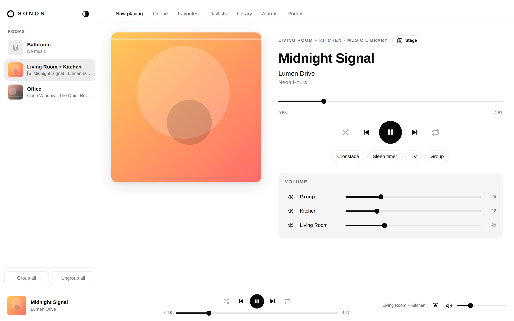
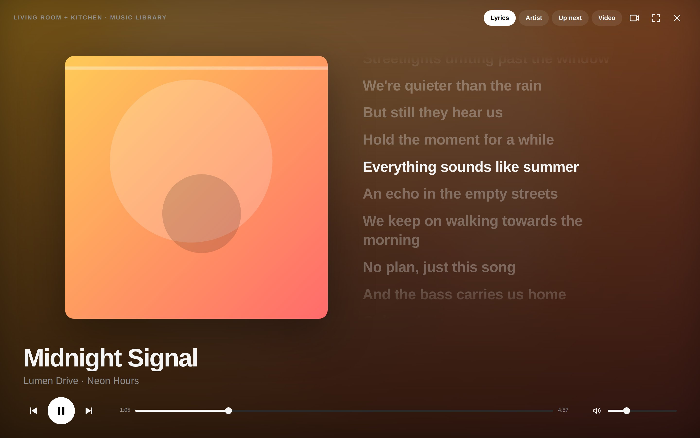

# Sonos Web

A clean web interface for Sonos – a white light theme and a black dark theme (follows your system, or switch it with the icon in the top-left corner).
It controls your speakers directly on the local network via UPnP (using the [SoCo](https://github.com/SoCo/SoCo) library) – no Sonos cloud, no account.

**Website & screenshots:** https://mupf-dev.github.io/sonos-web/



The interface is available in **English** and **German** and follows your browser language – adding another language is a single JSON file, see [Translating](#languages).

## Features

| Area | What you can do |
|---|---|
| **Now playing** | Cover art, title, seekable progress, play/pause, next/previous, shuffle, repeat (all/one), crossfade, sleep timer, switch to TV or line-in, group and per-room volume, mute |
| **Stage view** | Alternative now-playing view: large cover, background tinted with the album's colors, controls fade away, full screen; time-synced lyrics (LRCLIB), artist info (Wikipedia), up next, and a muted music video synced to playback – blurred in the background or up front |
| **Queue** | View, jump to a track, remove, reorder via drag & drop, clear, save as a Sonos playlist |
| **Music services** | Browse Spotify and other services (home page with reorderable rows, search, your library) – link once under *Rooms › Music services* |
| **Favorites** | Play or enqueue Sonos favorites (radio, Spotify playlists, …); service folders open in the browser |
| **Playlists** | Open, play, enqueue, rename and delete Sonos playlists, add tracks; cover mosaics (missing covers are looked up via a linked service) |
| **Library** | Browse the local music library (NAS/shares) by artist, album, track, genre, composer, imported playlists and folders; search; re-index |
| **Alarms** | Create, edit, delete and toggle alarms – time, room, recurrence (including specific weekdays), music from favorites, volume, duration, play mode |
| **Rooms** | Group/ungroup, party mode; per speaker: bass, treble, balance, loudness, night mode, speech enhancement, subwoofer, surround, Trueplay (model-dependent), name, status light, button lock, device info |

Keyboard: Space = play/pause, ↑/↓ = volume, Shift + ←/→ = previous/next track.



## Getting started

```bash
git clone https://github.com/mupf-dev/sonos-web
cd sonos-web
./run.sh            # http://localhost:8080
./run.sh --demo     # demo mode with simulated rooms, no speakers needed
./run.sh --port 9000
```

On first start, a virtual environment (`.venv`) is created automatically. Requires Python 3.10+.

### Docker (e.g. on a Raspberry Pi or NAS)

```bash
docker compose up -d --build   # http://<host>:8080
```

`network_mode: host` is required for automatic discovery to work.

## Finding your speakers

Discovery uses SSDP multicast and only works when the server runs **on the same network** as the speakers.
If nothing is found, the interface shows a connection dialog: enter the IP address of **one** speaker
(Sonos app › Settings › System › About my system) – all other rooms are found through it.
Alternatively, set the environment variable `SONOS_HOSTS=192.168.178.40` or use the network scan in the dialog.

**WSL2:** In the default NAT mode, WSL does not see multicast traffic from your home network. Either enter the IP
(unicast works) or enable mirrored networking in `%UserProfile%\.wslconfig` and restart WSL:

```ini
[wsl2]
networkingMode=mirrored
```

The `windows/` folder contains PowerShell scripts that apply and revert this setting (with a backup).

To use the interface from a phone or tablet, run the server on a device on your home network (e.g. via Docker).

## Languages

English (primary) and German are included. The interface uses your browser language when available, otherwise English; you can switch under *Rooms › Language* (stored per device).

To add a language, copy `static/i18n/en.json` to `static/i18n/<code>.json`, set `_meta.name` and translate the values – it is picked up automatically, no code changes needed. See [TRANSLATING.md](TRANSLATING.md) for placeholders, plurals and how to find missing keys.

## Project layout

```
app/main.py            REST API (FastAPI), docs at /api/docs
app/sonos_service.py   speaker control via SoCo
app/music_services.py  music services (Spotify & co.) via the Sonos SMAPI
app/media_info.py      lyrics, artist info and music videos
app/demo_service.py    simulated system for demo mode
static/                user interface (HTML/CSS/JS, no build step)
static/i18n/           translations, one JSON file per language
docs/                  GitHub Pages website
data/                  local settings, service tokens and cover cache (created automatically, not in git)
```

## Privacy & security

- **External services:** In the stage view, artist, title, album and duration are sent to lrclib.net (lyrics), wikipedia.org (artist info) and YouTube (music video, embedded via youtube-nocookie.com). Missing playlist covers are looked up via a linked music service.
- **Music services:** To browse a service, the interface links itself to it once (like an additional Sonos controller). The token is stored in `data/music_tokens.json`; the speakers' own sign-in is not affected.
- **No login:** Anyone who can reach the page on your network can control the speakers – just like with the Sonos app. Do not expose it to the internet.

## License

[MIT](LICENSE) © 2026 Marc Leunig

Not an official Sonos product. Sonos is a trademark of Sonos, Inc.
